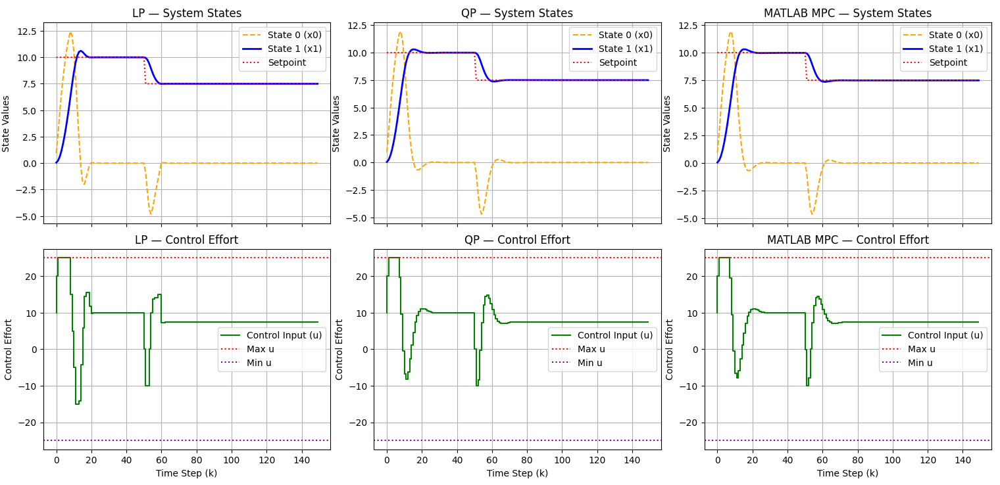
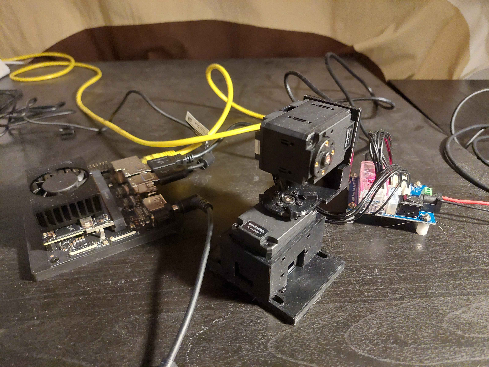
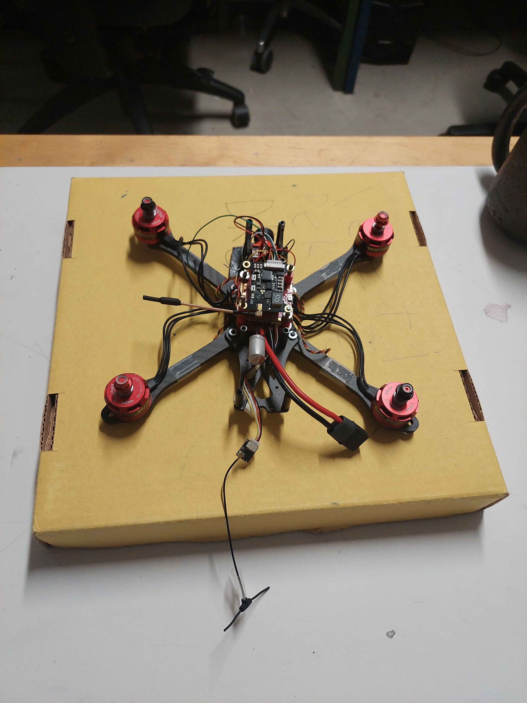

# Veeti Pekonen — Control Systems & Robotics
I'm a master's student in automation engineering at Tampere university, graduating in December 2026. Since 2024 I have worked as a research assistant at IHA-laboratory, developing control systems for a full-size electric wheelloader. My work has covered data callection, modeling, controller desing, systems desing and field testing. In my master's thesis I develop an optimization based algorithm for safe shared control of wheelloader, which prevents the user from colliding with obstacles while being minimally invasive.

Outside work I have personal projects which nclude ongoing projects like my C++ "control_toolbox" and camera turret and old projects like a drone I built in 2024. At the start of this year I also started tinkering with an openclaw agent using open source models.

## control_toolbox
In this project I have developed optimization and control algorithms like QP-optimizer, PID and MPC in C++ without using external libraries like Eigen or libraries with ready optimization algorithms. In the project I have implemented everything from basic linear algebra to working MPC algorithm which supports linear and quadratic costfunctions. Currently I'm working on optimizing the MPC-algorithm.
The repository can be accessed [here](https://github.com/VP1701/control_toolbox) 

I have tested the MPC algorithm against MATLABs MPC and results with QP cost were almost identical to MATLAB and with LP cost they obviously differed but the controller still worked. The MPC was tested on a double integrator system with 2 inputs and 2 outputs. Results can be seen in picture below.

*Comparison of my MPC algorithm with QP and LP costs against MATLAB's MPC with a QP cost.*

### WIP MPC control of quadcopter
In this project I develop position control for a quadcopter. This means that the controller would be the outer control loop on a real quadcopter. The first iteration uses a state space model linearized around hover and it is controlled with QP-MPC and tested in simulation. The benefit of MPC over more classical methods like PID or LQR is that MPC can incorporate constraints to inputs and states, which can increase reliability and performance in situations where the quadcopter is operated near its operating limits.

The current model has state vector x = [px, py, pz, vx, vy, vz, phi, theta]^T and 
inputs u = [phi_r, theta_r, T_r]^T, where T_r is thrust relative to hover. I assume that attitude is controlled by a low level controller which can be modeled as first order system.

[link to branch](https://github.com/VP1701/control_toolbox/tree/drone_test)

## Servo turret

In the camera turret project I'm building a turret with 2 servos and a camera. The goal is for it to be able to track moving things like a hand or a person. Currently the project is in it's start phase because the camera I ordered hasn't yet arrived. So far I have 3D printed a base and a joint piece for the turret and I have mounted the servos on it. A small snippet test code has also been made for configuring and moving the servos. Next steps are to make a kinematic model of the turret and make control for it that are required for target tracking and when the camera arrives to design and 3D print a mounting plate for it.

## Quadcopter
I have built my own quadcopter in 2024. In this project I learned the basic components needed in a quadcopter and in general working with electronics, soldering etc. In the future goal is to buy a new stm32 based flight controller and port my own controller to it. This is a long term goal which needs completion of the controller in the control_toolbox project before starting.

## Openclaw agent

I run a self-hosted AI assistant system on my own workstation using
[OpenClaw](https://docs.openclaw.ai), an open-source agent gateway. Everything
runs locally in Docker: the language model (Qwen3.6-35B-A3B, 4-bit GPTQ) is
served with vLLM across two GPUs and web search goes through a self-hosted SearXNG instance. Communication with the agent is done through telegram.

Because the agent can execute shell commands, I run it inside a Docker container so that if something goes wrong it can’t affect the rest of my PC. The container only has access to the agent’s own working files, SSH key, used for backing up its workspace to git.