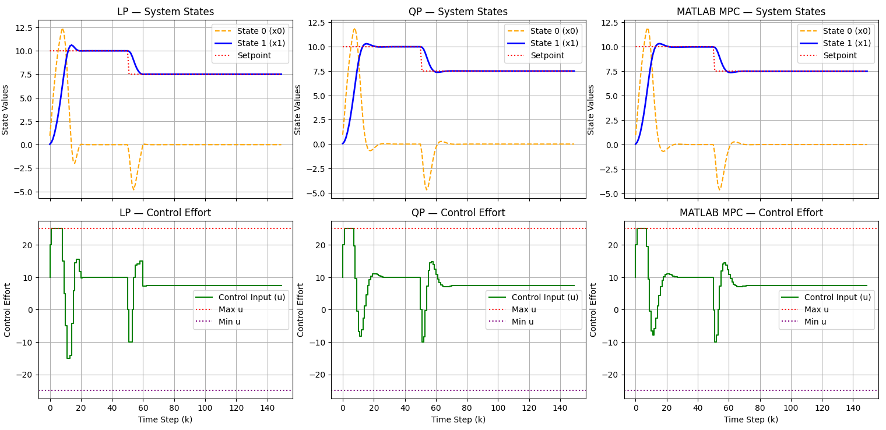

# Veeti Pekonen — Control Systems & Robotics
I'm a master's student in automation engineering at Tampere university, graduating in December 2026. Since 2024 I have worked as a research assistant at IHA-laboratory, developing control systems for a full-size electric wheelloader. My work has covered data callection, modeling, controller desing, systems desing and field testing. In my master's thesis I develop an optimization based algorithm for safe shared control of wheelloader, which prevents the user from colliding with obstacles while being minimally invasive.

Outside work I have personal projects which I will showcase on this page. They include ongoing projects like my C++ "control_toolbox" and camera turret and old projects like a drone I built at the start of my studies.

## control_toolbox
In this project I have developed optimization and control algorithms like QP-optimizer, PID and MPC in C++ without using external libraries like Eigen or libraries with ready optimization algorithms. In the project I have implemented everything from basic linear algebra to working MPC algorithm which supports linear and quadratic costfunctions. Currently I'm working on optimizing the MPC-algorithm. 

